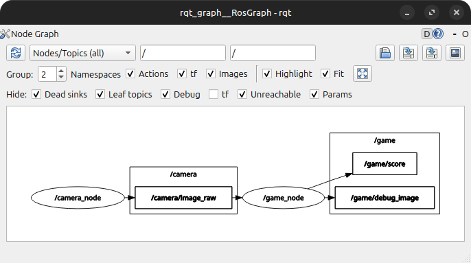
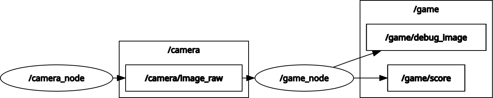

# Tugas ROS2 dan OpenCV Internship RIVAL

## Daftar Isi

1. [Demo](#demo)
2. [Struktur Repositori](#struktur-repositori)
3. [Cara Menjalankan](#cara-menjalankan)
4. [Arsitektur Sistem](#arsitektur-sistem)
5. [Parameter](#parameter)
6. [Asumsi dan Keputusan Desain](#asumsi-dan-keputusan-desain)
7. [Kendala dan Cara Mengatasinya](#kendala-dan-cara-mengatasinya)
8. [Bonus yang Dikerjakan](#bonus-yang-dikerjakan)

## Demo

- **Video demo:**

    https://github.com/user-attachments/assets/23cdb200-d619-4a2b-98a5-c1ec0b3fc48b.mp4

- **Screenshot `rqt_graph`:**

    

## Struktur Repositori

```
.
├── docs
│   ├── rosgraph.png
│   └── rqt_graph.png
├── README.md
└── src
    └── bouncing_ball_catcher
        ├── CMakeLists.txt
        ├── launch
        │   └── bouncing_ball_catcher_launch.yaml
        ├── package.xml
        └── src
            ├── camera_node.cpp
            └── game_node.cpp
```

## Cara Menjalankan

### 1. Clone dan build

```bash
git clone https://github.com/Hallherout/DaffaDaniswara_bouncing-ball-catcher.git
cd DaffaDaniswara_bouncing-ball-catcher/
colcon build
source install/setup.bash
```

### 2. Jalankan lewat launch file

Menggunakan webcam (default, indeks `0`):

```bash
ros2 launch bouncing_ball_catcher bouncing_ball_catcher_launch.yaml
```

Menggunakan webcam indeks `1` atau file video:

```bash
# Webcam indeks 1
ros2 launch bouncing_ball_catcher bouncing_ball_catcher_launch.yaml source:=1

# File video
ros2 launch bouncing_ball_catcher bouncing_ball_catcher_launch.yaml source:=/path/ke/video.mp4
```

### 3. Cara bermain

1. Pilih objek berwarna (bola kecil, tutup botol, atau kertas berwarna) yang warnanya sesuai dengan rentang `hsv_lower` / `hsv_upper`
2. Pegang objek di depan kamera hingga kotak pembatas (bounding box) muncul di `debug_image`
3. Arahkan objek ke dalam sebuah bola virtual dan tahan selama 2 detik tanpa putus
4. Jika berhasil, skor bertambah 1 dan bola muncul di posisi acak

## Arsitektur Sistem



### Node

| Node | Tugas |
| --- | --- |
| `camera_node` | Membaca webcam atau file video, lalu mempublikasikan frame sebagai `sensor_msgs/Image`. Video diputar ulang dari awal ketika selesai (loop). |
| `game_node` | Subscribe gambar, mendeteksi objek berwarna (HSV), menjalankan logika game, lalu mempublikasikan skor dan gambar beranotasi. |

### Topic
 
| Topic | Tipe pesan | Publisher | Subscriber | Keterangan |
| --- | --- | --- | --- | --- |
| `/camera/image_raw` | `sensor_msgs/Image` | `camera_node` | `game_node` | Frame mentah dari kamera |
| `/game/score` | `std_msgs/Int32` | `game_node` | TIdak ada subscriber | Skor saat ini, dipublikasikan setiap berubah |
| `/game/debug_image` | `sensor_msgs/Image` | `game_node` | `rqt_image_view` | Frame dengan anotasi bola, objek terdeteksi, dan skor |

### Alur kerja `game_node` (per frame)
 
1. **Deteksi objek:** konversi frame ke HSV, segmentasi dengan `inRange(hsv_lower, hsv_upper)`, lalu operasi morfologi (open dan close) untuk mengurangi noise.
2. **Update bola:** setiap bola digerakkan sesuai arahnya dan memantul saat menyentuh tepi frame.
3. **Pemilihan kontur:** ambil kontur terbesar. Jika luasnya di bawah `min_area`, objek dianggap **tidak terdeteksi**. Jika terdeteksi, gambar bounding box dan centroid pada `debug_image`.
4. **Cek tabrakan:** centroid objek dibandingkan dengan setiap bola. Jika centroid berada di dalam beberapa bola yang tumpang tindih, hanya bola dengan jarak centroid **terdekat** yang dihitung.
5. **Timer per bola:** timer bola yang sedang dilacak bertambah. timer bola lain direset ke 0. Jika timer mencapai `hold_duration`, skor +1, bola direspawn di posisi acak, dan timernya direset.
6. **Render dan publish:** gambar bola, progres timer, dan skor di sudut layar, lalu publikasikan ke `/game/debug_image`. `/game/score` dipublikasikan setiap skor berubah.

## Parameter

### `camera_node`

| Parameter | Tipe | Default | Fungsi |
| --- | --- | --- | --- |
| `source` | string | `"0"` | Indeks webcam atau path file video |
| `fps` | double | `30.0` | Frame rate publikasi |
| `width` | int | `640` | Lebar frame |
| `height` | int | `480` | Tinggi frame |

### `game_node`

| Parameter | Tipe | Default | Fungsi |
| --- | --- | --- | --- |
| `hsv_lower` | int array [3] | `{85, 70, 70}` | Batas bawah HSV |
| `hsv_upper` | int array [3] | `{105, 255, 255}` | Batas atas HSV |
| `num_balls` | int | `3` | Jumlah bola virtual |
| `hold_duration` | double | `2.0` | Durasi tahan (detik) untuk mendapat skor |
| `ball_radius` | int | `40` | Radius bola (piksel) |
| `ball_speed` | double | `150.0` | Kecepatan bola (piksel per detik) |
| `min_area` | int | `300` | Luas minimum kontur agar dianggap objek |

Parameter dapat diatur saat launch atau `ros2 param set`:

```bash
ros2 launch bouncing_ball_catcher bouncing_ball_catcher_launch.yaml ball_radius:=80 fps:=24

ros2 param set /game_node ball_speed 100.0
```

## Asumsi dan Keputusan Desain

- **Waktu berbasis timestamp:** Durasi tahan dihitung dari `header.stamp` (atau jam ROS), bukan dari jumlah frame, sehingga game tetap benar walaupun frame rate berubah atau ada frame yang terlewat.
- **Timer per bola:** Setiap bola punya timer sendiri. Timer di-reset ke 0 jika objek keluar dari bola atau tidak terdeteksi, sehingga aturan "tanpa putus" terpenuhi.
- **Satu objek pemain:** Hanya kontur terbesar yang dipakai sebagai objek pemain, dan posisinya diwakili oleh centroid kontur tersebut.
- **Bola tumpang tindih:** Jika centroid berada di dalam lebih dari satu bola, hanya bola dengan jarak centroid terdekat yang dihitung.
- **Pantulan di tepi frame:** Bola memantul ketika tepinya menyentuh batas frame, dengan memperhitungkan radius bola.
- **Posisi dan arah awal acak:** Posisi awal dan arah kecepatan bola diacak, begitu pula posisi respawn.


## Kendala dan Cara Mengatasinya

| Kendala | Cara mengatasi |
| --- | --- |
| konversi `cv::Mat` ke `sensor_msgs/Image` agar bisa dipublish | memakai `cv_bridge` |
| file video terbalik atas bawah ketika dimasukkan ke `cv::Mat` | memakai `cv::flip` dengan flipCode `0` |
| update posisi bola tiap frame | menghitung selisih antar frame dan mengalikan dengan kecepatan bola |
| kecepatan bola tidak berubah saat `ball_speed` diganti dengan `ros2 param set` | menambahkan callback untuk kalkulasi ulang kecepatan setelah setelah parameter `ball_speed` diganti |
| error type pada launch file | mendefinisikan `type:` pada tiap parameter |

## Bonus yang Dikerjakan

- [x] **Parameter dinamis:** parameter dapat diubah saat game berjalan lewat `ros2 param set`
- [ ] **Kalibrasi HSV:** tool/mode untuk menentukan rentang warna
- [ ] **Tracking lebih halus:** filter/smoothing posisi objek
- [ ] **Variasi bola:** pantulan antar bola, percepatan bertahap, atau bola makin cepat seiring skor naik
- [ ] **Service:** `std_srvs/Trigger` untuk me-reset game dan skor
- [ ] **Custom message/action** untuk status game
- [ ] **Mode game:** batas waktu ronde, nyawa, atau bola "bom"
